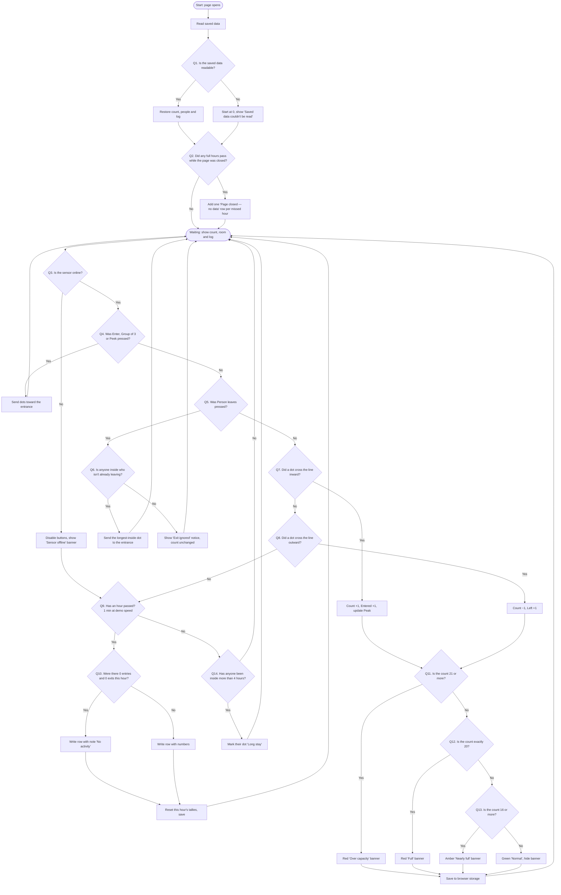

# 04 Flow chart

Rectangles are actions. Diamonds are questions, each numbered Q1–Q14 with a Yes and a No path. Every path ends back at **Waiting**, which is the way back to the start of the loop.

## The questions in words

| # | Question | Yes | No |
|---|---|---|---|
| Q1 | Is the saved data readable? | Restore it | Start at 0, show notice |
| Q2 | Did any full hours pass while the page was closed? | Add a "no data" row for each | Go to Waiting |
| Q3 | Is the sensor online? | Check the buttons (Q4) | Disable buttons, show banner, still check the clock (Q9) |
| Q4 | Was Enter, Group of 3 or Peek pressed? | Send dots in | Check Q5 |
| Q5 | Was Person leaves pressed? | Check Q6 | Check Q7 |
| Q6 | Is anyone inside who isn't already leaving? | Send a dot out | Show "Exit ignored" |
| Q7 | Did a dot cross the line inward? | Count +1, check level | Check Q8 |
| Q8 | Did a dot cross the line outward? | Count −1, check level | Check Q9 |
| Q9 | Has an hour passed (1 minute at demo speed)? | Check Q10 | Check Q14 |
| Q10 | Were there 0 entries and 0 exits this hour? | Row with "No activity" | Row with numbers |
| Q11 | Is the count 21 or more? | Over capacity | Check Q12 |
| Q12 | Is the count exactly 20? | Full | Check Q13 |
| Q13 | Is the count 16 or more? | Nearly full | Normal |
| Q14 | Has anyone been inside more than 4 hours (4 minutes at demo speed)? | Mark "Long stay" | Go to Waiting |

Peek in follows the same path twice: once through Q7 (in) and once through Q8 (out).
